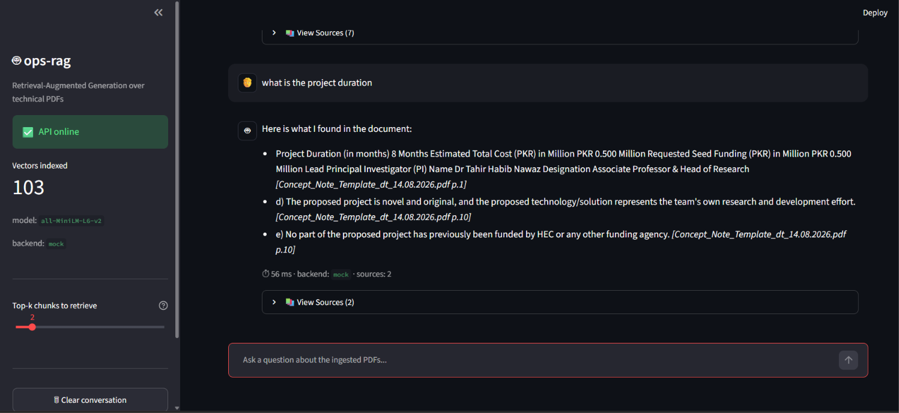

# ops-rag: Production-Grade RAG Pipeline & Evaluation



`ops-rag` is a flagship portfolio project demonstrating end-to-end Retrieval-Augmented Generation (RAG) engineering. It goes beyond a basic "chat with a PDF" script by implementing **rigorous retrieval evaluation (Hit Rate@3, MRR)**, a **modular backend/frontend architecture**, and **explicit source citation** to eliminate LLM hallucination.

## 🏗️ Architecture

1. **Data Ingestion:** `pypdf` + `RecursiveCharacterTextSplitter` for page-aware, overlapping chunking.
2. **Embeddings:** `all-MiniLM-L6-v2` (384-dim dense vectors) via `sentence-transformers`.
3. **Vector Database:** Local `ChromaDB` (persistent, cosine similarity, HNSW index).
4. **Generation:** Extractive `MockLLM` (deterministic, key-free) or local `Ollama` (`llama3.2`).
5. **Backend:** `FastAPI` with structured Pydantic response models and singleton model caching.
6. **Frontend:** `Streamlit` chat interface with citation badges and expandable raw text sources.
7. **Evaluation:** Custom script measuring retrieval Hit Rate and Mean Reciprocal Rank.

## 🚀 Quickstart

```bash
# 1. Clone & setup environment
git clone https://github.com/YOUR_USERNAME/ops-rag.git
cd ops-rag
python -m venv .venv
# Activate venv (Windows: .venv\Scripts\activate | Mac/Linux: source .venv/bin/activate)
pip install -r requirements.txt

# 2. Ingest a PDF (place your file in data/pdfs/ first)
python scripts/ingest_pdf.py --chunk-size 300 --overlap 50

# 3. Build the ChromaDB index
python scripts/build_vector_store.py

# 4. Evaluate retrieval (Hit Rate@3 / MRR)
python scripts/evaluate_retrieval.py

# 5. Start the FastAPI backend
python -m uvicorn src.serving.api:app --port 8000

# 6. Start the Streamlit UI (in a new terminal)
streamlit run dashboard/app.py